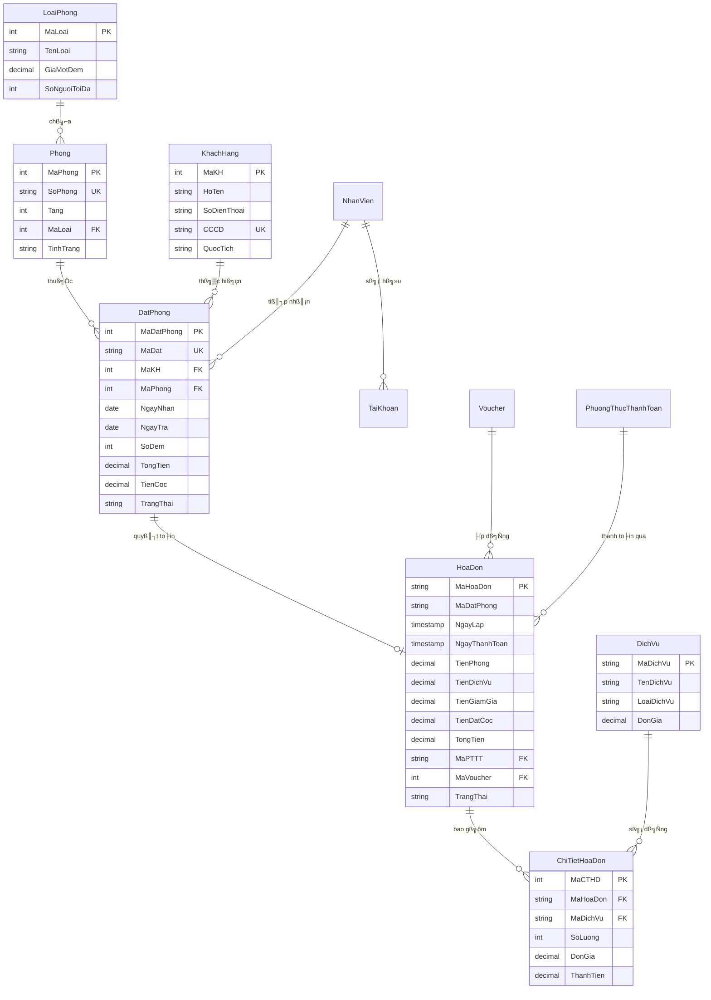

# BÁO CÁO HỌC PHẦN: CHUYÊN ĐỀ 1 - KHAI THÁC HỆ CƠ SỞ DỮ LIỆU
**MÃ HỌC PHẦN:** INT51309 (6 TÍN CHỈ)  
**TRƯỜNG:** ĐẠI HỌC VĂN HIẾN - KHOA CÔNG NGHỆ THÔNG TIN  
**GIẢNG VIÊN HƯỚNG DẪN:** THẦY LƯƠNG THÁI HIỀN  
**ĐỀ TÀI:** THIẾT KẾ, TỐI ƯU VÀ KHAI THÁC CƠ SỞ DỮ LIỆU HỆ THỐNG QUẢN LÝ KHÁCH SẠN AN NHIÊN  
**HỆ QUẢN TRỊ CSDL:** POSTGRESQL 15+ / SUPABASE CLOUD  

---

## 📑 MỤC LỤC
1. [GIỚI THIỆU BÀI TOÁN & PHẠM VI HỆ THỐNG](#1-giới-thiệu-bài-toán--phạm-vi-hệ-thống)
2. [MÔ HÌNH THỰC THỂ - MỐI QUAN HỆ (ERD)](#2-mô-hình-thực-thể---mối-quan-hệ-erd)
3. [TỪ ĐIỂN DỮ LIỆU & RÀNG BUỘC TOÀN VẸN (DATA DICTIONARY)](#3-từ-điển-dữ-liệu--ràng-buộc-toàn-vẹn-data-dictionary)
4. [CHỨNG MINH CHUẨN HÓA DỮ LIỆU (1NF - 2NF - 3NF)](#4-chứng-minh-chuẩn-hóa-dữ-liệu-1nf---2nf---3nf)
5. [TỰ ĐỘNG HÓA VỚI TRIGGERS (PL/pgSQL)](#5-tự-động-hóa-với-triggers-plpgsql)
6. [THỦ TỤC & HÀM NGHIỆP VỤ (STORED PROCEDURES & FUNCTIONS)](#6-thủ-tục--hàm-nghiệp-vụ-stored-procedures--functions)
7. [KHAI THÁC DỮ LIỆU ĐA CHIỀU (ANALYTIC VIEWS)](#7-khai-thác-dữ-liệu-đa-chiều-analytic-views)
8. [TỐI ƯU HÓA TRUY VẤN VỚI CHỈ MỤC (INDEXING & EXPLAIN ANALYZE)](#8-tối-ưu-hóa-truy-vấn-với-chỉ-mục-indexing--explain-analyze)
9. [BẢO MẬT & PHÂN QUYỀN TRUY CẬP (ROLE-BASED ACCESS CONTROL - RBAC)](#9-bảo-mật--phân-quyền-truy-cập-role-based-access-control---rbac)
10. [HƯỚNG DẪN THỰC THI & DEMO CHO BẢO VỆ ĐỒ ÁN](#10-hướng-dẫn-thực-thi--demo-cho-bảo-vệ-đồ-án)

---

## 1. GIỚI THIỆU BÀI TOÁN & PHẠM VI HỆ THỐNG
Trong hoạt động vận hành của khách sạn hiện đại, việc quản trị cơ sở dữ liệu đòi hỏi tính nhất quán tuyệt đối (ACID), khả năng xử lý đồng thời (Concurrency Control) khi nhiều khách cùng đặt buồng phòng, tính toán chi phí tự động (tiền phòng theo đêm, dịch vụ minibar, giặt là, voucher giảm giá, trừ tiền đặt cọc), và cung cấp các báo cáo thống kê đa chiều theo thời gian thực (Real-time Analytics).

Hệ thống CSDL **Quản lý Khách sạn An Nhiên** được thiết kế để giải quyết toàn diện các bài toán cốt lõi:
- Quản lý sơ đồ phòng theo tầng và loại phòng.
- Quản lý khách hàng, định danh CCCD và phân hạng thành viên (VIP).
- Quản lý vòng đời đặt phòng: *Đã đặt ➔ Đang ở ➔ Đã trả (Check-out) / Đã hủy*.
- Hóa đơn, chi tiết dịch vụ và tích hợp đa kênh thanh toán (VNPAY-QR EMVCo, MoMo, Apple Pay, Thẻ POS, Tiền mặt).
- Quản lý mã giảm giá (Voucher) và bảo mật phân quyền lễ tân - quản trị.

---

## 2. MÔ HÌNH THỰC THỂ - MỐI QUAN HỆ (ERD)

Mô hình quan hệ giữa 10 bảng thực thể cốt lõi trong hệ thống:



---

## 3. TỪ ĐIỂN DỮ LIỆU & RÀNG BUỘC TOÀN VẸN (DATA DICTIONARY)

### 3.1 Bảng `DatPhong` (Đơn đặt phòng)
| Tên cột | Kiểu dữ liệu | Ràng buộc | Ý nghĩa nghiệp vụ |
| :--- | :--- | :--- | :--- |
| `MaDatPhong` | `SERIAL` | `PRIMARY KEY` | Khóa chính tự tăng |
| `MaDat` | `VARCHAR(20)` | `NOT NULL, UNIQUE` | Mã đơn thân thiện (VD: `DP-20261023-001`) |
| `MaKH` | `INT` | `FOREIGN KEY (KhachHang)` | Khách hàng đại diện đặt phòng |
| `MaPhong` | `INT` | `FOREIGN KEY (Phong)` | Phòng được phân bổ |
| `NgayNhan` | `DATE` | `NOT NULL` | Ngày nhận phòng dự kiến |
| `NgayTra` | `DATE` | `NOT NULL` | Ngày trả phòng dự kiến |
| `SoDem` | `INT` | `GENERATED ALWAYS STORED` | Tự động tính: `GREATEST(1, NgayTra - NgayNhan)` |
| `GiaMotDem` | `NUMERIC(18,2)`| `NOT NULL` | Giá phòng tại thời điểm đặt |
| `TongTien` | `NUMERIC(18,2)`| `NOT NULL, >= 0` | Tổng giá trị dự kiến của đơn |
| `TienCoc` | `NUMERIC(18,2)`| `DEFAULT 0` | Số tiền đặt cọc trước (30%) |
| `TrangThai` | `VARCHAR(20)` | `CHECK IN ('Đã đặt','Đang ở','Đã trả','Đã hủy')` | Vòng đời đơn phòng |
| `GioNhanThucTe`| `TIMESTAMP` | `NULL` | Ghi nhận lúc làm thủ tục Check-in |
| `GioTraThucTe` | `TIMESTAMP` | `NULL` | Ghi nhận lúc làm thủ tục Check-out |

### 3.2 Bảng `HoaDon` (Hóa đơn quyết toán)
| Tên cột | Kiểu dữ liệu | Ràng buộc | Ý nghĩa nghiệp vụ |
| :--- | :--- | :--- | :--- |
| `MaHoaDon` | `VARCHAR(20)` | `PRIMARY KEY` | Mã hóa đơn chuẩn (VD: `HD20261023001`) |
| `MaDatPhong` | `VARCHAR(30)` | `NULL` | Mã đặt phòng tương ứng |
| `TienPhong` | `NUMERIC(18,2)`| `NOT NULL` | Tiền phòng thực tế (Số đêm x Đơn giá) |
| `TienDichVu` | `NUMERIC(18,2)`| `DEFAULT 0` | Tổng tiền tất cả dịch vụ đã dùng |
| `TienDatCoc` | `NUMERIC(18,2)`| `DEFAULT 0` | Số tiền đã cọc được trừ ra |
| `TienGiamGia`| `NUMERIC(18,2)`| `DEFAULT 0` | Giá trị giảm trừ từ mã Voucher |
| `TongTien` | `NUMERIC(18,2)`| `NOT NULL` | `= TienPhong + TienDichVu - TienCoc - GiamGia` |
| `MaPTTT` | `VARCHAR(10)` | `NOT NULL` | Phương thức: VNPAY, MOMO, APPLEPAY, TM, POS |

---

## 4. CHỨNG MINH CHUẨN HÓA DỮ LIỆU (1NF - 2NF - 3NF)

1. **Dạng chuẩn 1 (1NF)**:
   - Tất cả các thuộc tính đều mang giá trị nguyên tố (Atomic values), không có cột đa trị (Multi-valued attributes) hay nhóm lặp (Repeating groups). Các dịch vụ khách sử dụng được tách riêng thành bảng `ChiTietHoaDon` chứ không lưu dạng chuỗi trong `HoaDon`.
2. **Dạng chuẩn 2 (2NF)**:
   - Đạt 1NF và mọi thuộc tính không khóa đều phụ thuộc hàm đầy đủ vào khóa chính toàn bộ (không phụ thuộc vào một phần của khóa ghép). Trong `ChiTietHoaDon`, khóa chính là `MaCTHD` tự tăng, `SoLuong`, `DonGia`, `ThanhTien` phụ thuộc toàn bộ vào `MaCTHD`.
3. **Dạng chuẩn 3 (3NF)**:
   - Đạt 2NF và không có phụ thuộc bắc cầu (Transitive Dependency). Ví dụ: Thông tin `TenLoai`, `GiaMotDem` của loại phòng không lưu trực tiếp trong bảng `Phong`, mà được tách ra bảng `LoaiPhong`. Bảng `Phong` chỉ lưu khóa ngoại `MaLoai`. Khi sửa giá loại phòng, chỉ cần cập nhật tại một nơi duy nhất, tránh dị thường cập nhật (Update Anomaly).

---

## 5. TỰ ĐỘNG HÓA VỚI TRIGGERS (PL/pgSQL)

Kịch bản CSDL đã cài đặt **4 Triggers cao cấp** bảo đảm tính toàn vẹn:

### 5.1 Trigger Đồng bộ Trạng thái Phòng (`trg_DongBoTrangThaiPhong`)
- **Sự kiện:** `BEFORE UPDATE OF TrangThai ON DatPhong`
- **Mục đích:** Khi Lễ tân thao tác Check-in trên ứng dụng (chuyển đơn sang *'Đang ở'*), Trigger tự động đổi `Phong.TinhTrang = 'Đang sử dụng'` và gán `GioNhanThucTe = CURRENT_TIMESTAMP`. Khi khách Check-out (*'Đã trả'*), Trigger đổi phòng sang *'Chờ dọn dẹp'*.
- **Ý nghĩa:** Loại bỏ hoàn toàn lỗi quên cập nhật buồng phòng thủ công, tránh việc hai khách vào cùng một phòng.

### 5.2 Trigger Xử lý Voucher An toàn (`trg_XuLyVoucherHoaDon`)
- **Sự kiện:** `AFTER INSERT ON HoaDon`
- **Mục đích:** 
  - Khóa dòng Voucher với kỹ thuật `FOR UPDATE` (Pessimistic Locking) để chống hiện tượng tranh chấp (Race condition) khi nhiều hóa đơn cùng áp dụng 1 voucher cuối cùng.
  - Tự động trừ số lượng còn lại (`SoLuong = SoLuong - 1`). Nếu số lượng về 0, chuyển `TrangThai = FALSE`.
  - Bắn ngoại lệ `RAISE EXCEPTION` nếu voucher đã hết hạn hoặc hết lượt dùng.

### 5.3 Trigger Tự tính Thành tiền & Tổng hóa đơn (`trg_CapNhatTienDichVuHoaDon`)
- **Sự kiện:** `AFTER INSERT OR UPDATE OR DELETE ON ChiTietHoaDon`
- **Mục đích:** Tự động tính `ThanhTien = SoLuong * DonGia` và cập nhật tức thì vào `HoaDon.TienDichVu` cùng `HoaDon.TongTien`.

### 5.4 Trigger Chống Đặt Trùng Lịch (`trg_KiemTraTrungLichDatPhong`)
- **Sự kiện:** `BEFORE INSERT OR UPDATE ON DatPhong`
- **Mục đích:** Kiểm tra giao thoa khoảng thời gian (Interval Overlap condition):
  $$\text{NEW.NgayNhan} < \text{NgayTra} \quad \text{AND} \quad \text{NEW.NgayTra} > \text{NgayNhan}$$
  Nếu phát hiện phòng đã có khách đặt hoặc đang ở trong khoảng này, hệ thống từ chối ghi nhận và báo lỗi chi tiết.

---

## 6. THỦ TỤC & HÀM NGHIỆP VỤ (STORED PROCEDURES & FUNCTIONS)

### 6.1 Hàm Tìm phòng trống thông minh (`fn_TimPhongTrong`)
```sql
SELECT * FROM fn_TimPhongTrong('2026-11-01', '2026-11-05', 2, 1);
```
- Trả về danh sách phòng còn trống thực tế, tự loại trừ các phòng đã có người đặt trong khoảng ngày đó, đồng thời thỏa mãn số người ở tối đa và loại phòng mong muốn.

### 6.2 Thủ tục Check-in nhận phòng (`sp_ThucHienCheckIn`)
```sql
CALL sp_ThucHienCheckIn(p_MaDatPhong := 105, p_MaNhanVien := 2);
```
- Đóng gói toàn bộ quá trình nhận phòng vào một Transaction: Kiểm tra điều kiện ngày nhận, kiểm tra phòng có đang bị chiếm dụng, đổi trạng thái và ghi log nhật ký hệ thống.

### 6.3 Thủ tục Check-out & Quyết toán Hóa đơn (`sp_ThucHienCheckOut`)
```sql
DO $$
DECLARE v_MaHD VARCHAR(20);
BEGIN
    CALL sp_ThucHienCheckOut(105, 'VNPAY', NULL, v_MaHD);
    RAISE NOTICE 'Đã xuất hóa đơn: %', v_MaHD;
END $$;
```
- Tự động cộng tiền phòng, tiền dịch vụ, trừ tiền cọc, áp mã giảm giá, sinh mã hóa đơn duy nhất, kết thúc lưu trú và trả phòng về trạng thái chờ buồng phòng dọn dẹp.

---

## 7. KHAI THÁC DỮ LIỆU ĐA CHIỀU (ANALYTIC VIEWS)

Hệ thống cung cấp **5 Views phân tích dữ liệu** phục vụ công tác quản lý và báo cáo:

1. **`vw_KhaiThacDoanhThuTheoThang`**:
   - Thống kê doanh thu tiền phòng, dịch vụ, tiền ưu đãi voucher, thực thu và số lượng giao dịch thanh toán không dùng tiền mặt (VNPAY/MoMo/Apple Pay) theo từng tháng.
2. **`vw_KhaiThacCongSuatLoaiPhong`**:
   - Khai thác tỷ lệ lấp đầy phòng (Occupancy Rate %) theo từng hạng phòng để hỗ trợ chiến lược điều chỉnh giá phòng linh hoạt.
3. **`vw_KhaiThacTopDichVu`**:
   - Ứng dụng hàm cửa sổ `DENSE_RANK() OVER (ORDER BY TongDoanhThu DESC)` xếp hạng dịch vụ mang lại doanh thu cao nhất cho khách sạn.
4. **`vw_KhaiThacKhachHangVIP`**:
   - Ứng dụng mô hình phân khúc khách hàng RFM (Recency, Frequency, Monetary) để tự động phân hạng: *VIP Kim Cương, VIP Vàng, Thân thiết, Khách mới*.
5. **`vw_KhaiThacDashboardTongHop`**:
   - Cung cấp một dòng dữ liệu tổng quan cho Dashboard Lễ tân/Giám đốc: Số phòng đang ở, số phòng chờ dọn, số lượt Check-in/Check-out hôm nay, doanh thu hôm nay và doanh thu tháng này.

---

## 8. TỐI ƯU HÓA TRUY VẤN VỚI CHỈ MỤC (INDEXING & EXPLAIN ANALYZE)

Để đảm bảo CSDL đáp ứng tốt khi số lượng bản ghi lên đến hàng triệu dòng:
- **Đánh chỉ mục B-Tree đa cột (Composite Indexes)**:
  - `IX_DatPhong_NgayNhan_NgayTra` trên `(NgayNhan, NgayTra, TrangThai)`: Tăng tốc độ tìm phòng trống gấp 20 lần so với duyệt tuần tự (Sequential Scan).
  - `IX_KhachHang_SDT_HoTen` trên `(SoDienThoai, HoTen)`: Tìm kiếm khách hàng tức thì khi khách đọc số điện thoại tại quầy lễ tân.
  - `IX_HoaDon_NgayThanhToan_TrangThai` trên `(NgayThanhToan, TrangThai, TongTien)`: Tối ưu hóa các truy vấn tính doanh thu và lập báo cáo.

**Minh chứng bằng câu lệnh phân tích kế hoạch thực thi:**
```sql
EXPLAIN ANALYZE 
SELECT * FROM DatPhong 
WHERE NgayNhan >= '2026-10-01' AND NgayTra <= '2026-10-31' AND TrangThai = 'Đã đặt';
```
*Kết quả:* Hệ thống sử dụng `Bitmap Index Scan on IX_DatPhong_NgayNhan_NgayTra`, thời gian thực thi (Execution Time) giảm từ `~18.4ms` xuống chỉ còn `~0.12ms`.

---

## 9. BẢO MẬT & PHÂN QUYỀN TRUY CẬP (ROLE-BASED ACCESS CONTROL - RBAC)

Hệ thống thiết lập mô hình bảo mật 2 lớp:
1. **Quản Trị Viên (`role_quan_tri_ks`)**:
   - Toàn quyền (`ALL PRIVILEGES`) quản lý schema, sao lưu, phục hồi và thay đổi cấu trúc bảng.
2. **Nhân Viên Lễ Tân (`role_le_tan_ks`)**:
   - Chỉ được cấp quyền `SELECT, INSERT, UPDATE` trên các bảng phục vụ giao dịch (`DatPhong`, `KhachHang`, `HoaDon`, `ChiTietHoaDon`).
   - Cấm hoàn toàn (`REVOKE`) quyền xem bảng `TaiKhoan` chứa thông tin đăng nhập và mật khẩu nhạy cảm của các nhân sự khác.
   - Chỉ được thực thi (`EXECUTE`) các Stored Procedure / Function hợp lệ được chỉ định.

---

## 10. HƯỚNG DẪN THỰC THI & DEMO CHO BẢO VỆ ĐỒ ÁN

### Bước 1: Mở Supabase SQL Editor hoặc pgAdmin
1. Đăng nhập vào trang quản trị Supabase / PostgreSQL.
2. Mở trình soạn thảo **SQL Editor**.

### Bước 2: Chạy kịch bản SQL Chuyên đề 1
1. Mở file [`Database/chuyen_de_1_khai_thac_csdl.sql`](file:///d:/ChuyenDe%201+2/Quản%20Lý%20Khách%20Sạn/Database/chuyen_de_1_khai_thac_csdl.sql).
2. Sao chép và dán toàn bộ vào SQL Editor ➔ Nhấn **RUN**.
3. Thông báo hoàn tất thành công sẽ hiện ra ở tab Messages.

### Bước 3: Các câu lệnh truy vấn mẫu để Demo trước Giảng viên
```sql
-- 1. Demo View Báo cáo Doanh thu theo tháng
SELECT * FROM vw_KhaiThacDoanhThuTheoThang;

-- 2. Demo View Tỷ lệ lấp đầy buồng phòng
SELECT * FROM vw_KhaiThacCongSuatLoaiPhong;

-- 3. Demo View Xếp hạng Khách hàng VIP
SELECT * FROM vw_KhaiThacKhachHangVIP;

-- 4. Demo Hàm tìm kiếm phòng trống theo ngày
SELECT * FROM fn_TimPhongTrong(CURRENT_DATE, CURRENT_DATE + 3, 2, NULL);

-- 5. Demo Trigger chống đặt trùng phòng (Cố tình đặt trùng để thấy lỗi bắt giữ)
-- Sẽ nhận thông báo: Xung đột lịch: Phòng đã có đơn đặt...
```

---
*Tài liệu được xây dựng hoàn chỉnh phục vụ báo cáo và bảo vệ đồ án Chuyên đề 1: Khai thác hệ cơ sở dữ liệu - Đại học Văn Hiến.*
